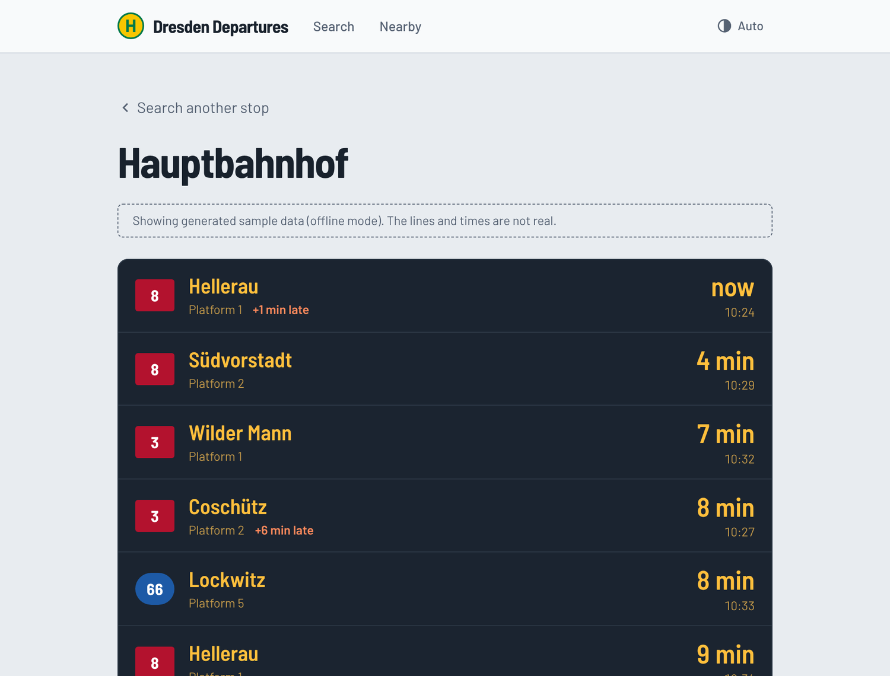
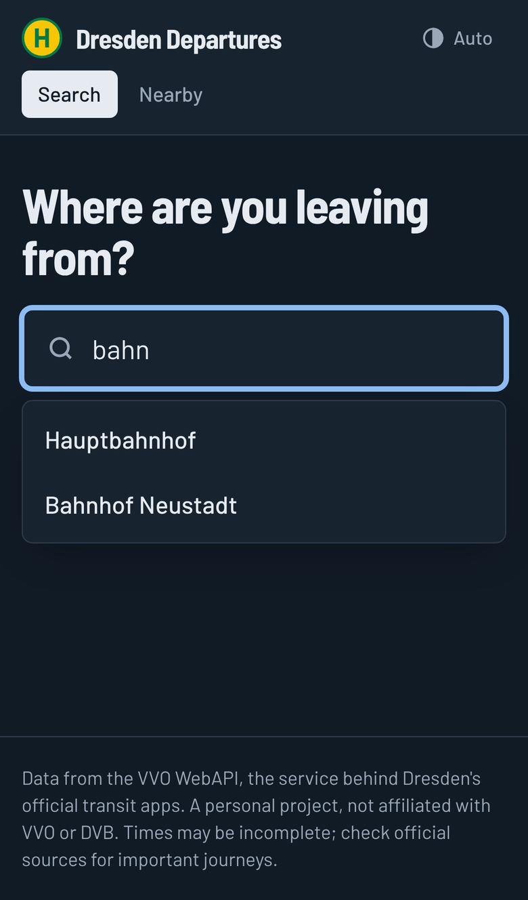
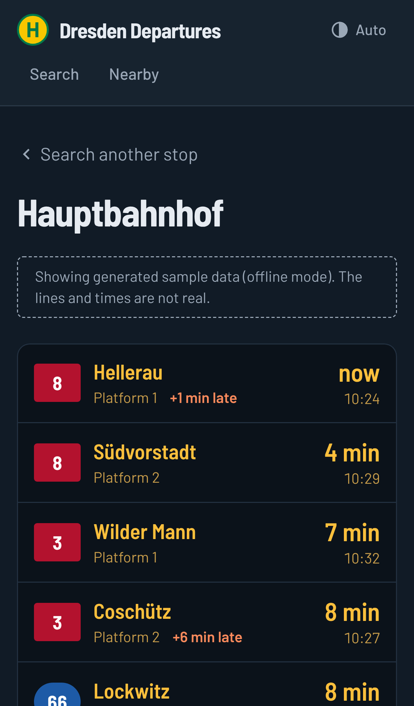
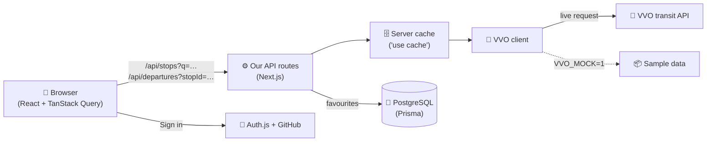

# 🚋 Dresden Departures

**A live departure board for Dresden's trams and buses: search a stop and see when the next ones leave.**

[](https://github.com/michael-panamarou/dresden-departures/actions/workflows/ci.yml)


🔗 **Live demo:** https://YOUR-PROJECT.vercel.app

| Departure board | Search on a phone (dark mode) | Board on a phone |
|---|---|---|
|  |  |  |

<sub>Screenshots use the app's built-in sample data.</sub>

---

## In short

> **For recruiters and non-technical readers:** this section explains the project in two minutes, no programming knowledge needed.

**What it does.** You type the name of a tram or bus stop in Dresden, for example *Postplatz*, and the app shows the next departures: which line, where it's going, from which platform, and whether it's running late. The board updates itself every 30 seconds. You can also find stops near you on a map, save your favourite stops after signing in with GitHub, use dark mode, and install the app on your phone's home screen.

**Why I built it.** This was my first full-stack web project, built step by step to learn modern web development from the ground up. I chose a problem I deal with every day in Dresden: checking when my tram leaves.

**What it shows about my skills.** It's a complete, real application working with live data, covering every layer of a professional web app:

| Area | In plain words |
|---|---|
| 🖥️ **Frontend** | A fast, accessible interface that works on phones and desktops, usable by keyboard and screen readers |
| ⚙️ **Backend** | A server that fetches transit data, checks every request, and passes data on safely |
| 🔌 **External data** | Live data from Dresden's public transport network, including converting German map coordinates to GPS |
| 🛡️ **Reliability** | Clear messages instead of crashes when the data source is slow or down; offline sample-data mode |
| 🔐 **Accounts and database** | Sign-in with GitHub and saved favourite stops in a PostgreSQL database |
| 🧪 **Quality** | 83 automated tests, including a real browser clicking through the app on desktop and phone sizes |
| 🚀 **Delivery** | Every change is checked automatically on GitHub and deployed to the internet |

---

## Features

- 🔎 **Stop search with suggestions while typing**, usable with mouse, touch or keyboard alone
- 🕒 **Live departure board**: line, direction, platform, minutes until departure, delays and cancellations, refreshed every 30 seconds
- 🎨 **Line badges by mode of transport**: red squares for trams, blue circles for buses, green for S-Bahn (shape and text label as well as colour)
- 🗺️ **Nearby stops on a map** (MapLibre + OpenStreetMap), with distances, based on your location
- ⭐ **Favourite stops** after signing in with GitHub, stored in PostgreSQL, the same on every device
- 🕘 **Recently viewed stops**, remembered in the browser without an account
- 🌙 **Dark mode** (automatic, or chosen manually) without a white flash on load
- 📱 **Responsive layout** and **installable as an app (PWA)**, with a friendly offline page
- 🧰 **Offline mode** with generated sample data, for development, demos and tests

---

## How it works



1. The browser **never talks to the transit API directly**, only to our own server. That keeps caching, error handling and data cleanup in one place.
2. The server **validates every request**, asks VVO, and turns its awkward raw format (pipe-separated strings, Microsoft date strings, German Gauss-Krüger coordinates) into clean, typed data.
3. Answers are **cached** at two levels: in the server (`"use cache"`) and in Vercel's CDN (`Cache-Control` headers). Stop names are reused for an hour, departures for 10 seconds, so a busy stop causes few requests to VVO.
4. When VVO is slow or down, users get a **clear message** (HTTP 502), and the technical details go to the server log.

---

## Tech stack

| Technology | What it's used for |
|---|---|
| [Next.js 16](https://nextjs.org) (App Router, Cache Components) | Pages and API routes in one project; server-side caching |
| [React 19](https://react.dev) + [TypeScript](https://www.typescriptlang.org) (strict) | User interface and type-checked code |
| [TanStack Query](https://tanstack.com/query) | Fetching, caching and auto-refreshing data in the browser |
| [Tailwind CSS 4](https://tailwindcss.com) | Styling, dark mode, responsive layout |
| [Auth.js](https://authjs.dev) (NextAuth v5) | Sign in with GitHub |
| [Prisma 7](https://www.prisma.io) + PostgreSQL | Database for favourites |
| [MapLibre GL](https://maplibre.org) + [OpenFreeMap](https://openfreemap.org) | Interactive map with free OpenStreetMap tiles |
| [proj4](https://github.com/proj4js/proj4js) | Converting VVO's Gauss-Krüger coordinates to GPS |
| [Vitest](https://vitest.dev) / [Playwright](https://playwright.dev) | Unit tests / end-to-end tests in a real browser |
| GitHub Actions + Dependabot | Automatic checks on every push; dependency updates |
| [Vercel](https://vercel.com) | Hosting and CDN |

---

## Run it locally

**Requirements:** [Node.js](https://nodejs.org) 22.12 or newer, and Git.

```bash
git clone https://github.com/YOUR-USERNAME/dresden-departures.git
cd dresden-departures
npm install
cp .env.example .env.local
npm run dev
```

Open <http://localhost:3000>. That's all you need: search, departures, the map, dark mode and the PWA work without any accounts or database.

**Offline mode:** set `VVO_MOCK=1` in `.env.local` and restart `npm run dev`. The app then uses five sample stops with generated departures, and shows a notice saying so.

### Enable favourites (optional)

Favourites need GitHub sign-in and a database. They switch on automatically once all four settings in `.env.local` are filled in:

1. **Database:** create a free PostgreSQL database, for example at [neon.tech](https://neon.tech). Copy its connection string into `DATABASE_URL`.
2. **Create the table:** `npm run db:migrate`
3. **GitHub OAuth app:** on GitHub, go to *Settings → Developer settings → OAuth Apps → New OAuth App*.
   - Homepage URL: `http://localhost:3000`
   - Authorization callback URL: `http://localhost:3000/api/auth/callback/github`
   - Copy the Client ID into `AUTH_GITHUB_ID`, generate a client secret and copy it into `AUTH_GITHUB_SECRET`.
4. **Secret:** run `npx auth secret` and copy the value into `AUTH_SECRET`.
5. Restart `npm run dev`. A **Sign in** button appears in the header.

### Deploy to Vercel

1. Push the repository to GitHub, then on [vercel.com](https://vercel.com) choose *Add New → Project* and import it. Vercel detects Next.js automatically.
2. For favourites, add the four variables from `.env.example` under *Settings → Environment Variables*, and create a **second** GitHub OAuth app whose URLs use your Vercel domain (e.g. `https://YOUR-PROJECT.vercel.app/api/auth/callback/github`). Run `npm run db:migrate` once against the production database.
3. Every push to `main` deploys automatically; pull requests get preview deployments.

> The favourites switch is read when the app is built, so redeploy after adding or removing these variables.

### Commands

| Command | What it does |
|---|---|
| `npm run dev` | Start the development server |
| `npm run lint` | Check code quality (ESLint) |
| `npm run typecheck` | Check TypeScript types across the project |
| `npm test` | Run the unit tests (Vitest) |
| `npm run test:e2e` | Build the app and run the browser tests (first time: `npx playwright install chromium`) |
| `npm run build` / `npm start` | Build and run the production version |
| `npm run db:migrate` | Create or update the database tables |
| `npm run db:studio` | Browse the database in your browser (Prisma Studio) |

---

## API

All endpoints answer JSON. Errors always look like `{ "error": "a message for people" }`.

| Endpoint | Returns | Errors |
|---|---|---|
| `GET /api/stops?q=postplatz` | `{ stops: Stop[], source }`; fewer than 2 characters → empty list | 400 query too long · 502 VVO unavailable |
| `GET /api/stops/nearby?lat=51.05&lng=13.73` | `{ stops: NearbyStop[], source }`, nearest first, with distance in metres | 400 missing position or outside the VVO area · 502 |
| `GET /api/departures?stopId=33000028` | `{ stop, departures, fetchedAt, source }` | 400 malformed ID · 404 unknown stop · 502 |
| `GET` / `POST` / `DELETE /api/favorites` | The signed-in user's favourites | 401 not signed in · 404 feature not configured |

```bash
curl "http://localhost:3000/api/departures?stopId=33000028"
```

---

## Project structure

```
src/
├── app/                         pages and API routes (Next.js App Router)
│   ├── page.tsx                 home: search, favourites, recently viewed
│   ├── stops/[id]/              live departure board
│   ├── nearby/                  map of nearby stops
│   ├── api/                     stops, nearby, departures, favorites, auth
│   ├── layout.tsx               header, footer, theme script, providers
│   └── manifest.ts              PWA manifest
├── components/                  UI building blocks (search, board, map, badges …)
├── lib/
│   ├── vvo/                     everything about the VVO API
│   │   ├── client.ts            the only code that calls VVO (timeouts, 4 error checks)
│   │   ├── cached.ts            server-side caching with "use cache"
│   │   ├── parse.ts             raw VVO data → clean, typed objects
│   │   ├── dates.ts / geo.ts    Microsoft dates; Gauss-Krüger ↔ GPS
│   │   ├── mock.ts              sample data for offline mode and tests
│   │   └── types.ts             data shapes used across the app
│   ├── queries.ts               browser data fetching (TanStack Query hooks)
│   ├── favorites.ts / db.ts     database access (Prisma)
│   └── …                        time formatting, line styles, settings
├── auth.ts                      Auth.js configuration
prisma/                          database schema and migrations
e2e/                             Playwright browser tests
.github/                         CI workflow and Dependabot
```

---

## Decisions and trade-offs

- **Our own API in front of VVO.** VVO allows browser requests (CORS), but a server-side proxy gives caching, one place to adapt if VVO changes, and clean data for the frontend.
- **Departures load in the browser**, not during server rendering, because they refresh every 30 seconds anyway. The page itself is a static shell that loads instantly.
- **Sessions in an encrypted cookie (JWT)** instead of a user table: the database only stores favourites, keyed by the GitHub account ID.
- **Optional features turn themselves on.** A fresh clone runs with no accounts, keys or database, which keeps the project easy to try.
- **Errors from cached functions are returned, not thrown.** In production, Next.js hides the details of errors thrown inside `"use cache"`, so the cache returns `{ ok: false, reason }` and keeps failures for at most 2 seconds.
- **Colour is never the only signal.** Line badges also differ in shape and have text labels; delays are written out ("+3 min late").

---

## What I'd build next

- **Journey planner** from stop A to stop B, using VVO's trip endpoint
- **Delay notifications** for favourite stops (Web Push)
- **German interface** alongside English (internationalisation)
- **Official line colours** and live disruption notices
- **Automated accessibility checks** (axe) in the end-to-end tests
- **Rate limiting** on the API routes, to protect the free VVO service

---

## Data source and disclaimer

Transit data comes from the **VVO WebAPI** (`webapi.vvo-online.de`), the service behind the official Dresden transit apps. It is **not an official public API**. Thanks to the community documentation at [kiliankoe/vvo](https://github.com/kiliankoe/vvo). Map data © [OpenStreetMap](https://www.openstreetmap.org/copyright) contributors, tiles by [OpenFreeMap](https://openfreemap.org).

This is a personal learning project and is **not affiliated with** the Verkehrsverbund Oberelbe (VVO) or the Dresdner Verkehrsbetriebe (DVB). Departure times may be incomplete or inaccurate. For travel decisions, use the official apps.

---

## Author

**Your Name** · [GitHub](https://github.com/YOUR-USERNAME) · [LinkedIn](https://www.linkedin.com/in/YOUR-PROFILE)
