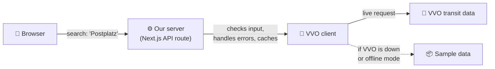

# 🚋 Dresden Departures

**A live departure board for Dresden's trams and buses: search a stop and see when the next ones leave.**


<!-- 📸 Screenshot or GIF goes here once the user interface is built (Stage 3–4):
 -->

🔗 **Live demo:** coming soon (deployment is Stage 5 of the roadmap)

---

## In short

> **For recruiters and non-technical readers:** this section explains the project in two minutes, no programming knowledge needed.

**What it does.** You type the name of a tram or bus stop in Dresden, for example *Postplatz*, and the app shows the next departures: which line, where it's going, from which platform, and whether it's running late. The board updates itself every 30 seconds.

**Why I built it.** This is my first full-stack web project, built step by step to learn modern web development from the ground up. I chose a problem I deal with every day as a Dresden resident: checking when my tram leaves.

**What it shows about my skills.** Instead of a tutorial exercise, it's a real application that works with real, live data. It covers the same layers as a professional web app:

| Area | In plain words |
|---|---|
| 🖥️ **Frontend** | The part people see and click in the browser |
| ⚙️ **Backend** | A small server that fetches transit data, checks it, and passes it on safely |
| 🔌 **External data** | Live data from Dresden's public transport network (VVO / DVB) |
| 🛡️ **Reliability** | The app keeps working, with clear messages, when the data source is slow or down |
| 🧪 **Quality checks** | Automatic checks for mistakes before code is saved; automated tests are next |
| 🚀 **Deployment** | Publishing the app on the internet so anyone can use it *(planned)* |

---

## Features

| Feature | Status |
|---|---|
| Stop search by name (server side, with input validation and caching) | ✅ Done |
| Offline / fallback mode with built-in sample data | ✅ Done |
| Search box with suggestions while typing | 🔜 Next |
| Departure board: lines, directions, platforms, delays, refresh every 30 s | 🔜 Planned |
| Log in with GitHub and save favourite stops | 🔜 Planned |
| Map of nearby stops | 🔜 Planned |
| Dark mode, mobile layout, installable as an app (PWA) | 🔜 Planned |

---

## How it works



1. The browser **never talks to the transit API directly**. It only asks our own server.
2. The server **checks the request**, asks the VVO data service, and **turns its raw, awkward format into clean data**.
3. If VVO is slow or unavailable, the user gets a **clear, friendly message** instead of a broken page, and the technical details are written to the server log for debugging.
4. Successful answers can be **cached**, so popular searches don't hit VVO again and again.

---

## Tech stack

| Technology | What it's used for |
|---|---|
| [Next.js 16](https://nextjs.org) (App Router) | The framework: web pages and the backend in one project |
| [React 19](https://react.dev) | Building the user interface from reusable components |
| [TypeScript](https://www.typescriptlang.org) | JavaScript with types, which catches many mistakes before the code runs |
| [Tailwind CSS 4](https://tailwindcss.com) | Styling the interface |
| ESLint | Automatic code quality checks |
| *Planned:* TanStack Query, Prisma + PostgreSQL, Auth.js, Vitest, Playwright, GitHub Actions, Vercel | Live data in the browser, database, login, automated tests, continuous integration, hosting |

---

## Run it locally

**Requirements:** [Node.js](https://nodejs.org) 20.9 or newer, and Git.

```bash
git clone https://github.com/YOUR-USERNAME/dresden-departures.git
cd dresden-departures
npm install
cp .env.example .env.local
npm run dev
```

Open <http://localhost:3000>.

**Offline mode:** set `VVO_MOCK=1` in `.env.local` and restart `npm run dev`. The app then uses built-in sample stops instead of the live API.

### Try the API

```bash
curl "http://localhost:3000/api/stops?q=bahn"
```

Example response in offline mode (`VVO_MOCK=1`):

```json
{
  "stops": [
    { "id": "33000028", "name": "Hauptbahnhof", "city": null, "gk4": { "up": 5657497, "right": 4621685 } },
    { "id": "33000016", "name": "Bahnhof Neustadt", "city": null, "gk4": { "up": 5660412, "right": 4622148 } }
  ]
}
```

`gk4` holds the stop's map coordinates in the German Gauss-Krüger system, as VVO sends them. They'll be converted to GPS for the map.

| Response | Meaning |
|---|---|
| `200` | Search worked (also for searches shorter than 2 characters, which return an empty list) |
| `400` | Search text longer than 100 characters |
| `502` | The VVO data service is unreachable or sent unusable data |
| `500` | Unexpected error in the app |

### Useful commands

| Command | What it does |
|---|---|
| `npm run dev` | Start the development server |
| `npm run typecheck` | Check the TypeScript types of the whole project |
| `npm run lint` | Check code quality |
| `npm run build` | Build the production version |

---

## Project structure

```
src/
├── app/
│   ├── api/stops/route.ts   → API endpoint: GET /api/stops?q=…
│   ├── layout.tsx           → frame around every page
│   └── page.tsx             → home page
└── lib/vvo/
    ├── client.ts            → the only code that talks to the VVO API (timeouts, error handling)
    ├── parse.ts             → turns VVO's raw data into clean objects
    ├── mock.ts              → sample data for offline mode
    └── types.ts             → the data shapes used across the app
```

---

## Roadmap: what I'd build next

- [x] **Stage 1:** Project setup, VVO client, stop search API
- [ ] **Stage 2:** Departures API with delay calculation and the first automated tests (Vitest)
- [ ] **Stage 3:** Search box with live suggestions
- [ ] **Stage 4:** Departure board with line colours and auto-refresh
- [ ] **Stage 5:** Automatic checks on every change (GitHub Actions) and live deployment (Vercel)
- [ ] **Stage 6:** GitHub login and favourite stops (Auth.js, Prisma, PostgreSQL)
- [ ] **Stage 7:** Map of nearby stops
- [ ] **Stage 8:** Dark mode, mobile layout, installable app (PWA)
- [ ] **Stage 9:** End-to-end browser tests (Playwright)

---

## Data source and disclaimer

Transit data comes from the **VVO WebAPI** (`webapi.vvo-online.de`), the service behind the official Dresden transit apps. It is **not an official public API**. Thanks to the community documentation at [kiliankoe/vvo](https://github.com/kiliankoe/vvo).

This is a personal learning project and is **not affiliated with** the Verkehrsverbund Oberelbe (VVO) or the Dresdner Verkehrsbetriebe (DVB). Departure times may be incomplete or inaccurate. For travel decisions, use the official apps.

---

## Author

**Your Name** · [GitHub](https://github.com/YOUR-USERNAME) · [LinkedIn](https://www.linkedin.com/in/YOUR-PROFILE) · your.email@example.com
